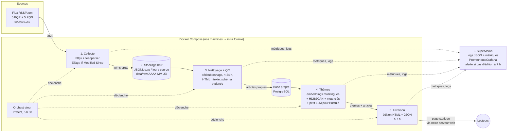

# La gazette — note de cadrage (TD 1)

**Équipe :** _à compléter_ · **Dépôt :** _lien_ · **Date :** 13/11/2026

## 1. Le besoin, avec nos mots
Chaque matin à 7 h, publier une « édition » qui répond à une question : **de quoi parlent les rédactions françaises aujourd'hui ?** On lit les flux publiés par une dizaine de titres (PQR + PQN), on regroupe les articles des dernières 24 h par **thèmes**, et pour chaque thème on affiche : un intitulé, les titres qui l'abordent, leurs sources et les liens pour lire la suite. On ne rédige rien à la place des journalistes : on cartographie.

## 2. Périmètre
| Dedans | Dehors |
|---|---|
| Collecte des flux RSS/Atom officiels (≥ 4 PQR, ≥ 4 PQN) | Scraping du texte intégral, contournement de paywall |
| Stockage brut (horodaté) + version nettoyée | Commentaires, profils, toute donnée personnelle |
| Contrôle qualité (doublons, dates, champs vides) | Résumé d'articles par LLM |
| Regroupement par thèmes + intitulé de thème | Front « joli », app mobile |
| Édition statique (HTML/Markdown + JSON) à 7 h | Personnalisation par utilisateur |
| Supervision (logs, métriques, alertes) | Monétisation |

**Ce qu'on garde par article :** titre, extrait du flux (chapô, tronqué à ~300 caractères), lien, date de publication, source. Jamais le corps de l'article.

## 3. Contraintes
- **Horaire :** édition disponible à 7 h → lancement du pipeline à 5 h 30, marge de 1 h 30 pour les relances.
- **Fraîcheur :** article publié depuis moins de 24 h (filtré sur `published`, repli sur la date de collecte si absente).
- **Éditeurs :** on n'utilise que les flux que l'éditeur publie lui-même ; on respecte robots.txt et les CGU ; on vérifie l'opposition à la fouille de textes (TDM, art. L122-5-3 CPI) ; on cite et on renvoie toujours à la source (droit voisin, loi 2019-775 : on n'en reproduit pas le contenu, on pointe vers lui).
- **RGPD :** aucune donnée personnelle. Le nom d'un auteur présent dans le flux n'est pas stocké.
- **Budget zéro :** nos machines + outils open source ; infra de prod fournie plus tard (TD 4 ou 6).
- **Robustesse avant fonctionnalités :** le temps restant va à la reprise sur erreur et à l'observabilité.

## 4. Architecture

**Ce qui circule :** XML des flux → enregistrements bruts (tels que reçus, + `fetched_at`, `source`) → articles normalisés (`id`=hash(url), `title`, `summary`, `url`, `published_at`, `source`, `type`, `region`) → table `themes` (`theme_id`, `label`, `keywords`, `articles[]`, `sources[]`) → `edition-AAAA-MM-JJ.html` + `.json`.

**Où ça tourne :** en local avec `docker compose` jusqu'au TD 4/6, puis sur l'infra fournie, décrite en code.

## 5. Stack retenue et pourquoi
| Brique            | Choix                                                                      | Pourquoi                                                                                                                                                                 | Écarté et pourquoi                                                                                               |
| ----------------- | -------------------------------------------------------------------------- | ------------------------------------------------------------------------------------------------------------------------------------------------------------------------ | ---------------------------------------------------------------------------------------------------------------- |
| Langage           | Python 3.12                                                                | écosystème RSS + NLP, compétences de l'équipe                                                                                                                            | Node : NLP plus pauvre                                                                                           |
| Collecte          | httpx + feedparser                                                         | feedparser tolère les flux mal formés ; httpx gère timeouts/retry                                                                                                        | Scrapy : surdimensionné, et on ne scrape pas les pages                                                           |
| Ordonnancement    | Prefect (serveur auto-hébergé)                                             | retries, logs et historique des runs sans la lourdeur d'Airflow                                                                                                          | Airflow : 4-5 conteneurs pour un DAG quotidien ; cron seul : pas de retry ni d'historique                        |
| Stockage brut     | fichiers JSONL gzip partitionnés par date                                  | rejouable, lisible, gratuit                                                                                                                                              | S3/MinIO : utile plus tard, pas indispensable au début                                                           |
| Stockage propre   | PostgreSQL                                                                 | Prefect a de toute façon besoin d'une base serveur : une seule instance sert les deux (bases `gazette` et `prefect`) ; accès concurrent du worker et des futurs services | DuckDB : un seul écrivain à la fois, et il faudrait quand même un Postgres pour Prefect *(choix révisé au TD 2)* |
| Thèmes            | sentence-transformers multilingue + HDBSCAN + c-TF-IDF (approche BERTopic) | fonctionne sur des titres courts, pas de nombre de thèmes à fixer                                                                                                        | LDA : mauvais sur des textes courts ; KMeans : impose k                                                          |
| Intitulé de thème | petit LLM local (Qwen2.5 1.5B–3B / Mistral 7B via Ollama)                  | nomme un groupe à partir de ses titres, sans rien résumer                                                                                                                | API payantes : budget zéro                                                                                       |
| Livraison         | HTML statique (Jinja2) + JSON, servi par un conteneur web (Caddy) sur notre serveur | édition hébergée sur notre infra, décrite dans le Compose comme le reste ; un serveur de fichiers suffit, rien à maintenir côté appli | appli web dynamique : hors sujet ; GitHub Pages : dépend d'un tiers et sort l'édition de notre infra |
| Supervision       | logs JSON structurés + Prometheus/Grafana                                  | métriques par étape et alertes                                                                                                                                           | ELK : trop lourd                                                                                                 |
| Conteneurs / IaC  | Docker Compose, puis Terraform/Ansible selon l'infra                       | reproductible                                                                                                                                                            | Kubernetes : surdimensionné                                                                                      |

## 6. Risques
| Risque                                  | Impact                         | Parade                                                             |
| --------------------------------------- | ------------------------------ | ------------------------------------------------------------------ |
| Un flux change d'URL ou tombe           | thèmes biaisés                 | alerte « 0 item pour la source X », sources de secours             |
| Dates absentes ou fausses dans le flux  | articles vieux de plus de 24 h | repli sur la date de collecte, contrôle QC                         |
| Doublons (agences AFP reprises partout) | faux « gros thème »            | dédoublonnage par URL canonique + similarité des titres            |
| Clustering instable d'un jour à l'autre | édition incohérente            | graine fixée, seuils versionnés, jeu de test annoté à la main      |
| LLM qui invente un intitulé             | thème trompeur                 | intitulé contraint aux mots-clés, repli sur les mots-clés c-TF-IDF |
| Conditions d'un éditeur incompatibles   | source à retirer               | colonne `conditions` revue à chaque ajout                          |
| Run en retard après 7 h                 | pas d'édition                  | lancement à 5 h 30, retries, alerte à 6 h 45                       |

## 7. Rôles
| Rôle                        | Qui         |
| --------------------------- | ----------- |
| Collecte + sources          | DN, AM      |
| Stockage + qualité          | AM, LB      |
| Thèmes / modèle             | DN, LB      |
| Orchestration + infra (IaC) | DN, AM      |
| Supervision + livraison     | DN, AM, LB  |

## 8. Suite
- **TD 2 — le socle :** dépôt, Docker Compose, structure du projet, configuration, CI minimale.
- **TD 3 — la collecte :** lecture de `sources.csv`, collecte, stockage brut, premiers contrôles.
